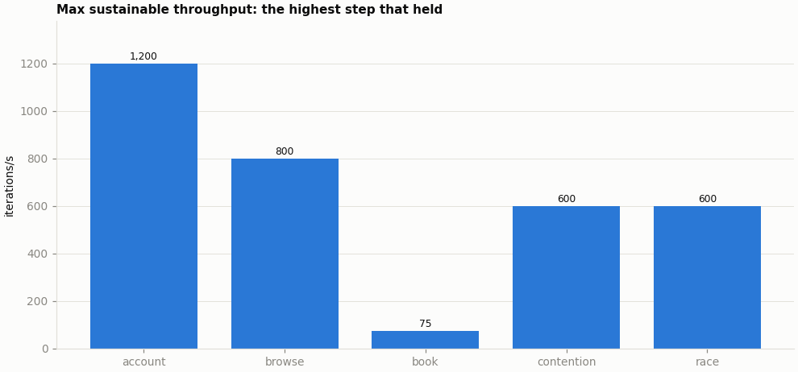
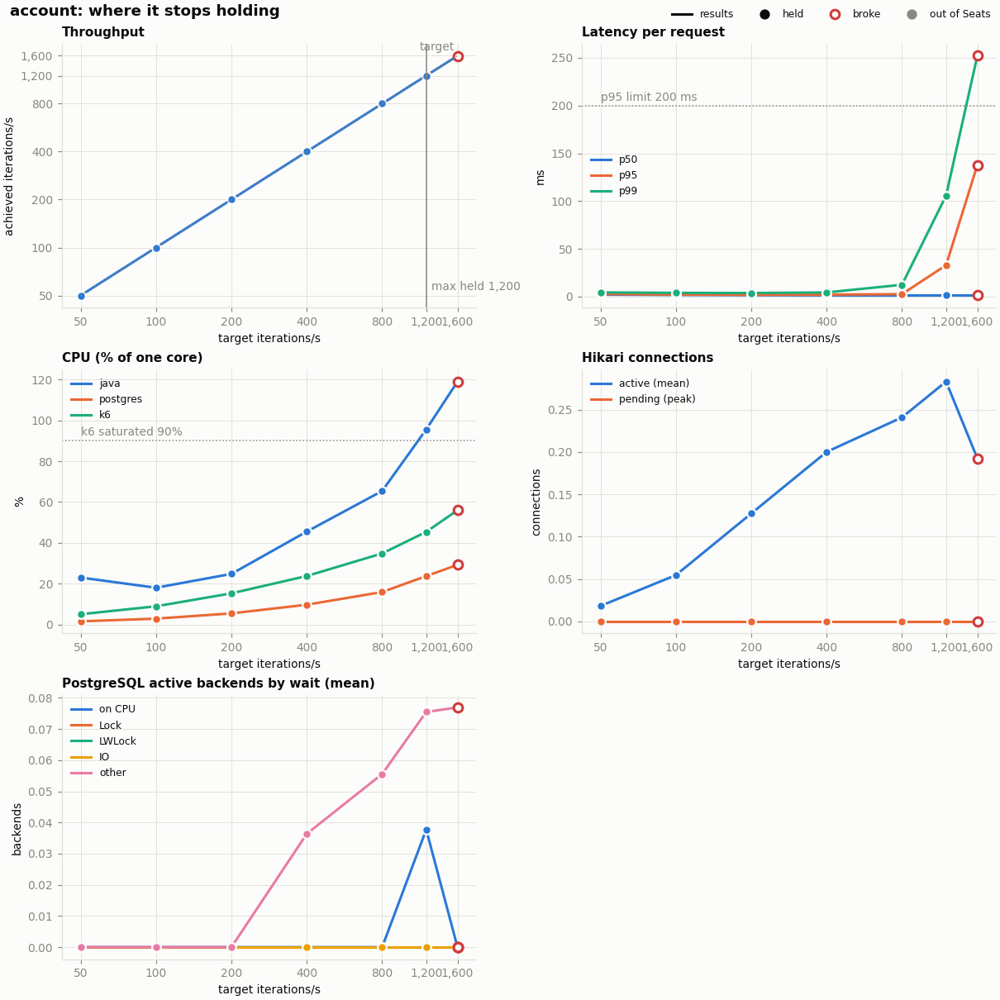
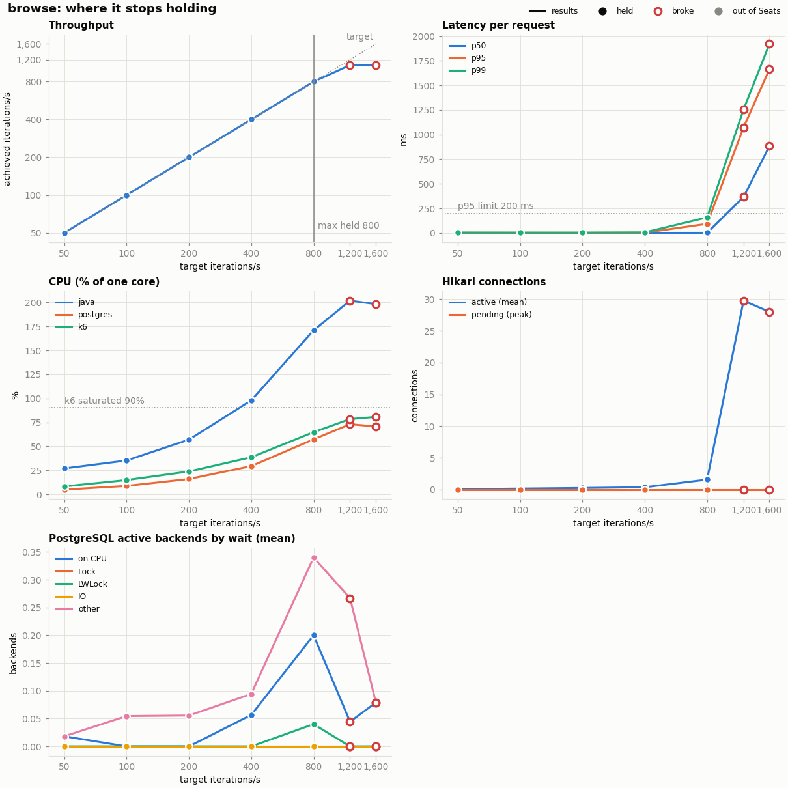
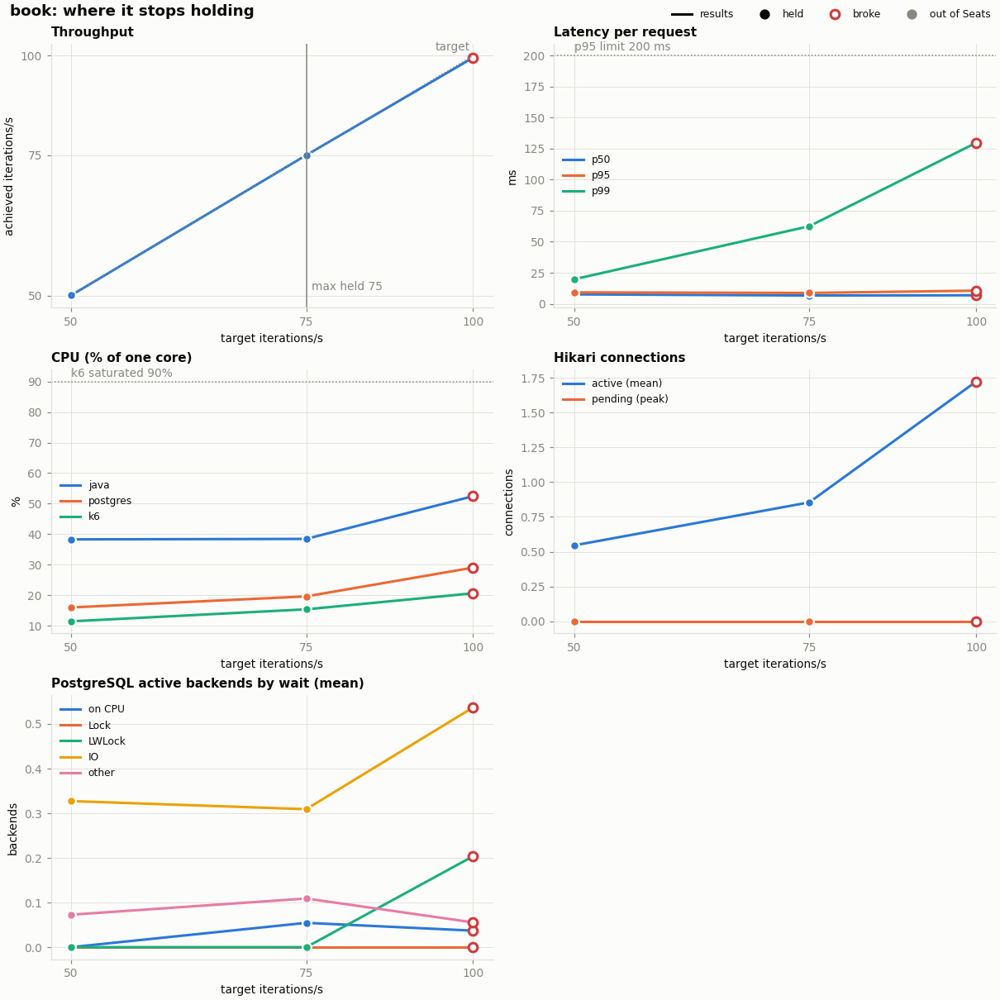
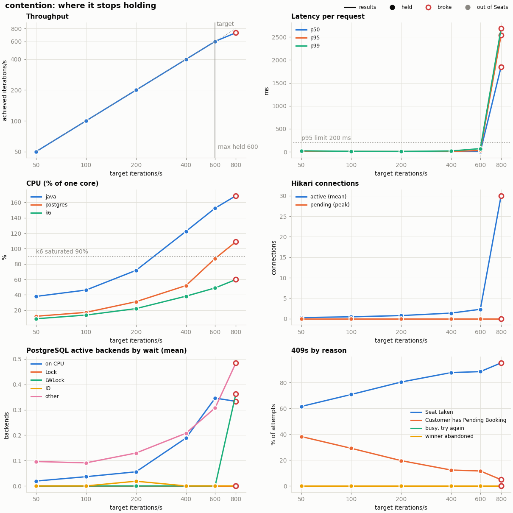
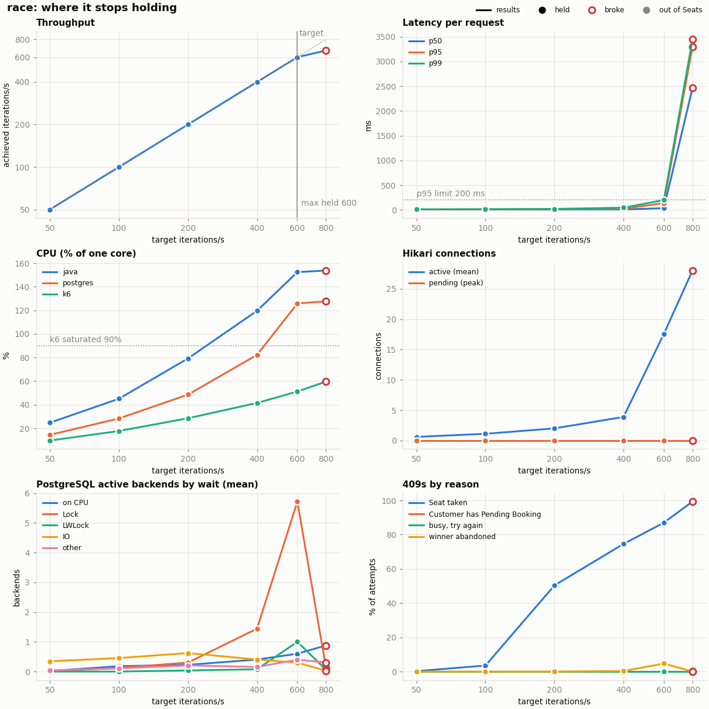

# Kết quả load test v1 trên Kaggle

Notebook Kaggle CPU `duongtung1812/kiem-thu-performance-ktpm-lan-1` đã chạy commit `755156f` trên nhánh `main` của kho `Duonglt1812/se-phase-02-test` vào ngày 2026-11-27 và hoàn thành cả năm scenario. Output thô được lưu ngoài Git, chỉ các biểu đồ và báo cáo này nằm trong kho mã nguồn. Báo cáo đối chiếu kết quả của v1 (`n = 1` lần chạy) với Phase 1 baseline tại commit `4d40ac3` (`n = 2` lần chạy) trong [loadtest-baseline.vi.md](loadtest-baseline.vi.md).

## Tóm tắt



| Scenario | Workflow | Phase 1 giữ được, it/s (Run 1 / Run 2) | v1 giữ được, it/s | Chênh lệch đo được (Run 1 / Run 2) | v1 hỏng đầu tiên, it/s | Đánh giá đối chiếu (`n = 1` ở v1, `n = 2` ở Phase 1) |
|---|---|---:|---:|---:|---:|---|
| account | Đọc tài khoản của khách hàng đang đăng nhập | 1,200 / 1,200 | 1,200 | 0% / 0% | 1,600 | Giữ nguyên bậc 1,200 it/s, nhưng p95 giảm từ 177.36 / 96.61 ms xuống 32.98 ms (-81.41% / -65.86%). Bậc 1,600 it/s chưa kết luận được do `account.js` hạ `preAllocatedVUs` xuống 512 và rớt 137 iteration khi Tomcat đỉnh chỉ 7/40 |
| browse | Liệt kê suất chiếu và mở một sơ đồ ghế | 400 / 400 (nghẽn k6) | 800 | +100% / +100% (trên bộ đo) | 1,200 | Đo được trần thực của server ở 800 it/s, hỏng ở 1,200 it/s do Java CPU 201.83% và Tomcat 40/40. Không tách riêng được mức tăng của server vì Phase 1 bị nghẽn k6 trên core 0 và `browse.js` ở v1 đã bỏ parse JSON |
| book | Giữ một ghế chưa dùng và thanh toán | 50 / none | 75 | +50% / n/a | 100 | Cải thiện bước đầu nhưng biên hẹp trên `n = 1` (Phase 1 hỏng vì 1 và 3 dropped iteration); vẫn nghẽn chờ ghi đĩa (`iowait` 17.47%, PostgreSQL IO wait 0.54 tại 100 it/s) |
| contention | Nhiều khách hàng cùng thử đặt 10 ghế cố định, vốn đang bị Hold | 200 / 400 | 600 | +200% / +50% | 800 | Cải thiện rõ ở 400 it/s (p95 từ 6,353.35 / 83.67 xuống 10.10 ms) và giữ 600 it/s; cần chạy lặp lại để kiểm chứng biên dao động giữa các phiên Kaggle. Hỏng ở 800 it/s do CPU (Java 168.65%, PostgreSQL 108.88%) và 43,542 rollback |
| race | Khách hàng giành cùng các ghế trống, và mỗi bên thắng bỏ đơn ngay | 200 / 300 | 600 | +200% / +100% | 800 | Cải thiện rõ tại 400 it/s (6,033 đơn `201` so với 206 / 873); tại 600 it/s tuy đạt `held` nhưng số đơn `201` thực tế giảm còn 2,999 do 91.67% lượt thử trả về `409` |

Step cao nhất còn giữ được là max sustainable throughput của scenario theo tiêu chuẩn ADR 0007 trong lần chạy này. Tất cả 12 step contention và race ở v1 đều qua kiểm tra SQL. Không ghế nào bị đặt hai lần, và số `201`, số đơn bị bỏ cùng tổng `409` khớp nhau hoàn toàn.

## Cách đọc kết quả

- Mỗi scenario warm-up ở 50 it/s mà không đo, rồi chạy các step 60 giây ở 50, 100, 200, cứ thế nhân đôi. Sau step hỏng đầu tiên, nếu giữa tốc độ cuối cùng còn giữ được và tốc độ bị hỏng còn khoảng cách lớn hơn 1, scenario chạy thêm một step ở điểm giữa. [ADR 0007](adr/0007-capacity-baseline-by-stepped-arrival-rate-runs.vi.md) giải thích quy trình này.
- Một step là `broke` nếu một trong các điều kiện sau đúng, ngược lại là `held`:
  - p95 latency trên 200 ms
  - hơn 1% request lỗi ngoài dự kiến
  - dưới 99% check đạt
  - có dropped iteration
  - tốc độ thực đạt dưới 95% mục tiêu
- `exhausted` nghĩa là `book` đã dùng hết ghế được seed, trường hợp này không tính là hỏng. Lần chạy v1 không dùng hết seed.
- it/s là số workflow iteration hoàn tất mỗi giây. RPS là số HTTP request mỗi giây. Hai scenario `browse` và `book` gửi hai HTTP request cho mỗi iteration.
- Bảng step được sắp theo tốc độ mục tiêu tăng dần. Do đó một step ở giữa như 75 it/s của `book` đứng trước step 100 it/s đã kích hoạt nó.
- Telemetry là giá trị trung bình trên cả step 60 giây, trừ khi ghi là đỉnh. CPU tính theo phần trăm của một core, nên 201.83% nghĩa là 2.02 core. Wait của PostgreSQL là số backend đang hoạt động trung bình ở mỗi loại wait.
- Mỗi step contention và race kết thúc bằng một lần kiểm tra SQL trên bảng `booked_seat`. Số đơn `201` trừ số đơn bị bỏ phải bằng số dòng ghế đã đặt, không có ghế nào xuất hiện hai lần, và mọi `409` phải thuộc bốn lý do đã biết là ghế đã có người lấy, khách hàng đã có đơn Pending, busy, hoặc ghế đã trống lại.
- Cột `Phase 1 p95, ms (chênh lệch)` ở mỗi bảng step ghi lần lượt p95 của Run 1 và Run 2 tại baseline rồi đến phần trăm chênh lệch theo công thức `(v1 - Phase 1) / Phase 1 * 100` trên số hai chữ số thập phân, không nội suy các step mà một trong hai phiên bản không chạy.

## Môi trường

| Mục | Phase 1 baseline (4d40ac3) | v1 (755156f) | Khác biệt và tác động |
|---|---|---|---|
| Commit mã nguồn | `4d40ac3add0fa3f8d26e8a2ac8cc4ef5fa138e45` | `755156f2203c365a4ca86ae952de745a67c8835e` | Mã nguồn mới chứa các tối ưu P1 đến P6 cùng tính năng S2, S3 |
| Phần cứng | 4 CPU, Intel Xeon @ 2.20 GHz, 31 GiB RAM | 4 CPU, Intel Xeon @ 2.20 GHz, 31 GiB RAM | Giữ nguyên, so sánh trực tiếp được về tài nguyên máy chủ |
| CPU affinity | k6 và notebook trên CPU 0; service và PostgreSQL trên CPU 1 đến 3 | k6 và notebook trên CPU 0; service và PostgreSQL trên CPU 1 đến 3 | Giữ nguyên tỷ lệ 1 core cho k6 và 3 core cho service cùng PostgreSQL |
| JVM và runtime | OpenJDK 21.0.12.1, G1 GC, không truyền JVM flag | OpenJDK 21.0.12.1, G1 GC, `-Xms1g -Xmx1g -XX:+AlwaysPreTouch -XX:MaxGCPauseMillis=20` | Khóa heap 1 GiB và giới hạn mục tiêu GC pause 20 ms, làm giảm thời gian dừng GC |
| Cơ sở dữ liệu | PostgreSQL 14.24 với cấu hình mặc định | PostgreSQL 16.15 đã tinh chỉnh (`shared_buffers` 1GB, `effective_cache_size` 4GB, `work_mem` 16MB, `random_page_cost` 1.1, `wal_writer_delay` 50ms, `commit_delay` 100, `commit_siblings` 3, `checkpoint_completion_target` 0.9) | Nâng cấp phiên bản chính và bật group commit với `commit_delay`, tách biệt chưa hoàn toàn với thay đổi mã nguồn |
| Pool và thread | Hikari pool 10 kết nối, Tomcat mặc định 200 thread | Hikari pool 40 kết nối, Tomcat max 40 thread, `min-spare` 40, `accept-count` 2000 | Cân bằng 40 thread Tomcat với 40 kết nối Hikari, triệt tiêu hàng đợi chờ kết nối Hikari |
| Kịch bản k6 | Đọc và parse JSON phản hồi ở cả năm scenario; `preAllocatedVUs` theo tốc độ mục tiêu (tối đa 2,000) | `account.js` và `browse.js` dùng `responseType: 'none'` (bỏ đọc body trong vùng đo); `account.js` thêm `setup()` làm ấm cache và giới hạn `preAllocatedVUs = 512`; ba scenario ghi giữ nguyên | Giảm tải CPU của k6 ở `browse` nhưng bỏ kiểm tra độ đầy đủ 120 ghế trong vùng đo, đồng thời làm `account` ở 1,600 it/s dễ rớt iteration hơn khi có gai độ trễ |
| Cờ nghiệp vụ và quan sát | Chưa có rate limit, anti-hoarding hay tracing | `RATE_LIMIT_ENABLED=false`, `ANTI_HOARDING_ENABLED=false`, `TRACING_SAMPLING_PROBABILITY=0.0`, `HTTP_ACCESS_LOG_LEVEL=WARN` | Đo riêng năng lực nhân đặt vé; khác với cấu hình mặc định trong `application.yml` (vốn giới hạn API 3,000 rpm và chặn giữ/hủy ghế liên tiếp) |
| Chiến lược giữ ghế | `unique` | `unique` (`SEAT_INVENTORY_STRATEGY=unique`) | Giữ nguyên chiến lược mặc định `unique` |
| Load generator | k6 v2.3.0 | k6 v2.3.0 | Giữ nguyên phiên bản k6 |

Lần chạy v1 thay đổi đồng thời mã nguồn ứng dụng, kịch bản k6 (`account.js` và `browse.js`), phiên bản và cấu hình PostgreSQL (16.15 so với 14.24), thông số JVM, kích thước pool Hikari cùng Tomcat, và tắt bốn cơ chế bảo vệ mặc định của Phase 2 (`rate-limit`, `anti-hoarding`, `tracing` sampling, HTTP access log INFO). Vì vậy kết quả v1 phản ánh năng lực của nhân ứng dụng trong cấu hình load test riêng, không tương đương cấu hình mặc định trong `application.yml` và không tách biệt hoàn toàn ảnh hưởng của phần mềm khỏi hạ tầng.

File `env.txt` của lần chạy này vẫn giữ tiêu đề mục cũ `JVM defaults (no flags are passed to the service)` cho lệnh kiểm tra `java -XX:+PrintFlagsFinal -version` độc lập. Trên thực tế, tiến trình JAR được khởi chạy kèm bốn JVM flag `-Xms1g`, `-Xmx1g`, `-XX:+AlwaysPreTouch` và `-XX:MaxGCPauseMillis=20` theo cell cấu hình của notebook.

<details>
<summary>Metadata của notebook, tham số và log khởi động</summary>

| Mục | Giá trị ghi nhận ở v1 |
|---|---|
| Kernel Kaggle | `duongtung1812/kiem-thu-performance-ktpm-lan-1` (private) |
| Thời điểm ghi `env.txt` | 2026-11-27 04:25:25 UTC |
| Thời điểm service khởi động | 2026-11-27 03:45:05 UTC |
| Kho và nhánh | `Duonglt1812/se-phase-02-test`, nhánh `main` |
| Cách lấy mã nguồn | `CODE_BUNDLE=None` (Git clone trực tiếp tại `755156f2203c365a4ca86ae952de745a67c8835e`, không dùng source bundle SHA-256) |
| Tham số load test | `SCENARIO=all`, `START_RATE=50`, `MAX_RATE=6400`, `DURATION=60s`, `K6_VERSION=v2.3.0` |
| Biến môi trường của service | `HTTP_ACCESS_LOG_LEVEL=WARN`, `TRACING_SAMPLING_PROBABILITY=0.0`, `HIBERNATE_JDBC_ERROR_LEVEL=ERROR`, `RATE_LIMIT_ENABLED=false`, `ANTI_HOARDING_ENABLED=false` |
| Thành phần runtime | Apache Tomcat 11.0.25, Hibernate ORM 7.4.5.Final (`hibernate.jdbc.batch_size=20`), Flyway 14 migration (`V1` đến `V14`) |
| Thống kê `app.log` | 224,773 dòng JSON, gồm 224,771 INFO, 2 WARN của SpringDoc lúc khởi động và 0 ERROR. Có 224,724 dòng INFO lặp lại `HHH100503: JDBC batch still contained JDBC statements on release` khi các giao dịch `contention` và `race` rollback sau lỗi unique constraint. |

</details>

## Các scenario

### Account



| mục tiêu it/s | đạt it/s | RPS | p50 ms | p95 ms | p99 ms | lỗi | checks | dropped | busy 409 | kết quả | Phase 1 p95, ms (chênh lệch) |
|---:|---:|---:|---:|---:|---:|---:|---:|---:|---:|---|---|
| 50 | 50.0 | 50.0 | 2.13 | 2.79 | 4.46 | 0.00% | 100.00% | 0 | 0 | held | 3.18 / 2.77 (-12.26% / +0.72%) |
| 100 | 100.0 | 100.0 | 1.79 | 2.19 | 4.02 | 0.00% | 100.00% | 0 | 0 | held | 2.40 / 1.97 (-8.75% / +11.17%) |
| 200 | 200.0 | 200.0 | 1.60 | 2.00 | 3.84 | 0.00% | 100.00% | 0 | 0 | held | 2.03 / 1.68 (-1.48% / +19.05%) |
| 400 | 400.0 | 400.0 | 1.40 | 2.17 | 4.45 | 0.00% | 100.00% | 0 | 0 | held | 2.23 / 1.95 (-2.69% / +11.28%) |
| 800 | 800.0 | 800.0 | 1.25 | 2.68 | 12.50 | 0.00% | 100.00% | 0 | 0 | held | 3.56 / 3.70 (-24.72% / -27.57%) |
| 1,200 | 1,200.0 | 1,200.0 | 1.35 | 32.98 | 105.78 | 0.00% | 100.00% | 0 | 0 | held | 177.36 / 96.61 (-81.41% / -65.86%) |
| 1,600 | 1,597.7 | 1,597.7 | 1.33 | 137.82 | 252.11 | 0.00% | 100.00% | 137 | 0 | broke: dropped iterations | 734.29 / 706.20 (-81.23% / -80.48%) |

Account giữ được mức 1,200 it/s bằng với Phase 1. Ở tải thấp 100 đến 400 it/s, p95 của v1 là 2.00 đến 2.19 ms, thấp hơn Run 1 (-1.48% đến -8.75%) nhưng cao hơn Run 2 (+11.17% đến +19.05% so với 1.68 đến 1.97 ms), nằm trong biên dao động dưới nửa mili-giây. Tại 1,200 it/s, p95 giảm từ 177.36 ms (Run 1) và 96.61 ms (Run 2) xuống 32.98 ms (-81.41% và -65.86%). Tại 1,600 it/s, p95 giảm từ 734.29 ms và 706.20 ms xuống 137.82 ms (-81.23% và -80.48%), nên v1 không còn vượt ngưỡng 200 ms và chỉ hỏng vì 137 dropped iteration với 0.00% lỗi. Không có tầng nào trong ứng dụng hay cơ sở dữ liệu bão hòa tại 1,600 it/s. Số thread Tomcat bận đạt đỉnh giảm từ 70 và 200 xuống 7, Hikari peak pending giảm từ 74 và 187 xuống 0, PostgreSQL dùng 29.22% CPU, k6 dùng 55.97% CPU và tổng GC pause giảm từ 393 ms và 380 ms xuống 81 ms (-79.39% và -78.68%). Lệnh `BEGIN READ ONLY` (95,591 và 95,774 lần ở Phase 1) không còn trong bảng SQL. Tuy nhiên, `account.js` ở v1 đặt `WARM_VUS = 512` (thay vì cấp sẵn 1,600 VU như Phase 1), làm `k6.log` ghi nhận `http_req_connecting` đạt đỉnh 114.59 ms và `http_req_duration` đạt đỉnh 387.87 ms khi k6 mở thêm VU giữa chừng, nên bước 1,600 it/s chưa cho thấy trần thực của server.

| Chỉ số | Phase 1 Run 1 / Run 2 (1,600 it/s) | v1 (1,600 it/s) | Khác biệt |
|---|---:|---:|---|
| Java CPU % | 129.97 / 135.06 | 118.99 | -10.98 / -16.07 điểm % |
| PostgreSQL CPU % | 41.35 / 36.83 | 29.22 | -12.13 / -7.61 điểm % |
| k6 CPU % | 58.43 / 56.28 | 55.97 | -2.46 / -0.31 điểm % |
| iowait % | 0.02 / 0.02 | 0.03 | +0.01 / +0.01 điểm % |
| Hikari active / pending đỉnh / acquire ms | 1.30 / 74 / 1.03 và 1.94 / 187 / 3.52 | 0.19 / 0 / 0.00 | Không còn hàng đợi pending (-74 / -187) |
| Thread Tomcat bận, đỉnh | 70 / 200 | 7 | -63 / -193 thread |
| Tổng GC pause ms | 393 / 380 | 81 | -312 / -299 ms (-79.39% / -78.68%) |
| Wait của PostgreSQL: CPU / Lock / LWLock / IO / khác | 0.08 / 0.00 / 0.00 / 0.00 / 0.04 và 0.02 / 0.00 / 0.00 / 0.00 / 0.09 | 0.00 / 0.00 / 0.00 / 0.00 / 0.08 | Giảm CPU wait về 0.00 |
| Deadlock / rollback | 0 / 0 và 0 / 0 | 0 / 0 | Không thay đổi |

<details>
<summary>Các câu SQL tốn nhất tại 1,600 it/s</summary>

| Số lần gọi | Tổng ms | Trung bình ms | Đoạn truy vấn đã chuẩn hóa |
|---:|---:|---:|---|
| 97,464 | 2,294 | 0.024 | `select id, email, password_hash, full_name, role from account where id = $1` |
| 1 | 0 | 0.139 | `insert into refresh_token (account_id,created_at,expires_at,family_id,replaced_by_token_id,revoked_at,token_hash,id) values ($1,$2,$3,$4,$5,$6,$7,$8)` |
| 1 | 0 | 0.032 | `select id, email, password_hash, full_name, role from account where email = $1` |

</details>

### Browse



| mục tiêu it/s | đạt it/s | RPS | p50 ms | p95 ms | p99 ms | lỗi | checks | dropped | busy 409 | kết quả | Phase 1 p95, ms (chênh lệch) |
|---:|---:|---:|---:|---:|---:|---:|---:|---:|---:|---|---|
| 50 | 50.0 | 100.0 | 2.41 | 3.24 | 4.91 | 0.00% | 100.00% | 0 | 0 | held | 4.22 / 3.85 (-23.22% / -15.84%) |
| 100 | 100.0 | 200.0 | 2.18 | 2.79 | 4.61 | 0.00% | 100.00% | 0 | 0 | held | 4.93 / 4.62 (-43.41% / -39.61%) |
| 200 | 200.0 | 400.0 | 1.90 | 2.78 | 4.65 | 0.00% | 100.00% | 0 | 0 | held | 9.95 / 8.69 (-72.06% / -68.01%) |
| 400 | 400.0 | 800.0 | 1.76 | 3.44 | 6.74 | 0.00% | 100.00% | 0 | 0 | held | 131.54 / 128.44 (-97.38% / -97.32%) |
| 800 | 800.0 | 1,600.0 | 2.43 | 93.63 | 158.54 | 0.00% | 100.00% | 0 | 0 | held | 2,060.38 / 1,920.25 (-95.46% / -95.12%, Phase 1 đều broke) |
| 1,200 | 1,083.5 | 2,167.0 | 366.96 | 1,073.38 | 1,255.83 | 0.00% | 100.00% | 6,992 | 0 | broke: p95 > 200 ms, dropped iterations, achieved < 95% of target | không đo |
| 1,600 | 1,084.8 | 2,169.5 | 883.76 | 1,665.42 | 1,921.88 | 0.00% | 100.00% | 30,916 | 0 | broke: p95 > 200 ms, dropped iterations, achieved < 95% of target | không đo |

Browse giữ được 800 it/s (1,600.0 RPS) so với mức 400 it/s ở Phase 1, tức gấp đôi trên quy trình đo này. Ở 400 it/s, p95 giảm từ 131.54 ms (Run 1) và 128.44 ms (Run 2) xuống 3.44 ms (-97.38% và -97.32%). Ở 800 it/s, p95 giảm từ 2,060.38 ms và 1,920.25 ms xuống 93.63 ms (-95.46% và -95.12%). Scenario hỏng ở 1,200 it/s khi tốc độ đạt dừng ở 1,083.5 it/s, p95 tăng lên 1,073.38 ms và có 6,992 dropped iteration, rồi vẫn bão hòa quanh 1,084.8 it/s ở 1,600 it/s. Tại 1,200 it/s, k6 chỉ dùng 78.42% CPU (80.67% ở 1,600 it/s), thấp hơn ngưỡng cảnh báo 90%, khác với Phase 1 khi k6 bão hòa 92.37% và 92.82% core 0 ở 600 it/s. Điểm nghẽn tại 1,200 it/s nằm ở server với Java dùng 201.83% CPU, PostgreSQL dùng 73.06% (tổng 274.89% trên ba core), toàn bộ 40 thread Tomcat đều bận và Hikari dùng trung bình 29.76 kết nối active với pending bằng 0. Truy vấn `select ... from seat` (9,674 ms và 9,372 ms ở Phase 1) biến mất nhờ cache sơ đồ ghế trong bộ nhớ (P3), thay bằng truy vấn danh sách `showtime` tốn 11,034 ms trên 65,011 lần gọi. Về phương pháp đo, không thể quy kết toàn bộ mức tăng từ 400 lên 800 it/s cho riêng server vì Phase 1 chưa chạm trần thực của server (do k6 nghẽn trước) và `browse.js` ở v1 (P6) đã chuyển sang `responseType: 'none'`, bỏ việc giải mã JSON và kiểm tra đủ 120 ghế trong từng iteration.

| Chỉ số tại 1,200 it/s | v1 (755156f) |
|---|---:|
| Java CPU % | 201.83 |
| PostgreSQL CPU % | 73.06 |
| k6 CPU % | 78.42 |
| iowait % | 0.01 |
| Hikari active / pending đỉnh / acquire ms | 29.76 / 0 / 0.00 |
| Thread Tomcat bận, đỉnh | 40 |
| Tổng GC pause ms | 243 |
| Wait của PostgreSQL: CPU / Lock / LWLock / IO / khác | 0.04 / 0.00 / 0.00 / 0.00 / 0.27 |
| Deadlock / rollback | 0 / 0 |

<details>
<summary>Các câu SQL tốn nhất tại 1,200 it/s</summary>

| Số lần gọi | Tổng ms | Trung bình ms | Đoạn truy vấn đã chuẩn hóa |
|---:|---:|---:|---|
| 65,011 | 11,034 | 0.170 | `select id, movie_id, auditorium_id, starts_at, ends_at, base_price, status, cancellation_reason, cancellation_note from showtime where starts_at >= $1 and starts_at < $2 and status <> 'CANCELLED' order by starts_at, id` |
| 65,010 | 1,552 | 0.024 | `select id, movie_id, auditorium_id, starts_at, ends_at, base_price, status, cancellation_reason, cancellation_note from showtime where id = $1` |
| 65,010 | 601 | 0.009 | `select s.seat_id as seatId, b.status as status from booked_seat s join booking b on b.id = s.booking_id where s.showtime_id = $1 and (b.status in ('CONFIRMED', 'REFUNDED') or (b.status = 'PENDING' and b.expires_at > $2))` |

</details>

### Book



| mục tiêu it/s | đạt it/s | RPS | p50 ms | p95 ms | p99 ms | lỗi | checks | dropped | busy 409 | kết quả | Phase 1 p95, ms (chênh lệch) |
|---:|---:|---:|---:|---:|---:|---:|---:|---:|---:|---|---|
| 50 | 50.0 | 100.0 | 7.54 | 9.16 | 19.72 | 0.00% | 99.98% | 0 | 0 | held | 9.89 / 8.28 (-7.38% / +10.63%, Run 2 broke) |
| 75 | 75.0 | 150.0 | 6.64 | 8.71 | 62.50 | 0.00% | 100.00% | 0 | 0 | held | 9.29 / không đo (-6.24%, Run 1 broke) |
| 100 | 99.5 | 198.9 | 6.82 | 10.55 | 129.78 | 0.00% | 99.99% | 34 | 0 | broke: dropped iterations | 9.83 / không đo (+7.32%, Run 1 dropped 80) |

Book đạt mức giữ được 75 it/s (150.0 RPS) với p95 8.71 ms và 0 dropped iteration, so với 50 it/s ở Run 1 (+50%) và `none` ở Run 2 của Phase 1. Ở 100 it/s, v1 vẫn hỏng chỉ vì dropped iteration, dù số iteration bị rớt giảm từ 80 ở Run 1 xuống 34 (-57.50%), p95 tăng nhẹ từ 9.83 ms lên 10.55 ms (+7.32%), p99 là 129.78 ms và lỗi bằng 0.00%. Step 50 it/s có 1 check thất bại trên 6,001 lần kiểm tra và step 100 it/s có 1 check thất bại trên 11,933 lần kiểm tra do HTTP `409 Seat already taken` ghi trong `k6.log`, khớp với 1 rollback trong cơ sở dữ liệu. Nguyên nhân là pha warm-up 50 it/s trong 60 giây chạy 3,001 iteration trong khi `SLOT_OFFSET` trong `loadtest/kaggle.ipynb` chỉ cộng `50 * 60 = 3,000`, làm trùng đúng 1 ghế ở ranh giới step, tương tự tỷ lệ check 99.98% và 99.99% ở Phase 1.

Tại 100 it/s, CPU của ba thành phần đều chưa bão hòa với Java dùng 52.44%, PostgreSQL dùng 29.02% và k6 dùng 20.62%. Tuy nhiên ở đúng cùng mức tải 50 và 75 it/s, mức `iowait` ở v1 (10.66% và 14.53%) và PostgreSQL IO wait (0.33 và 0.31) lại cao hơn Phase 1 (6.20% / 0.13 ở Run 2 tại 50 it/s; 12.43% / 0.22 ở Run 1 tại 75 it/s) vì mỗi đơn thành công ở v1 phải ghi thêm vào bảng `payment_transaction` (1,078 ms trên 5,966 lệnh insert tại 100 it/s) bù cho việc bỏ `select ... from seat` (888 ms và 550 ms ở Phase 1). Ngoài ra, ở Phase 1 ranh giới đạt/trượt của `book` được quyết định bởi 1 đến 3 dropped iteration (biên rất hẹp), nên kết quả 75 it/s với `n = 1` chưa đủ chứng minh mức độ ổn định qua nhiều phiên Kaggle.

| Chỉ số tại 100 it/s | v1 (755156f) |
|---|---:|
| Java CPU % | 52.44 |
| PostgreSQL CPU % | 29.02 |
| k6 CPU % | 20.62 |
| iowait % | 17.47 |
| Hikari active / pending đỉnh / acquire ms | 1.72 / 0 / 0.00 |
| Thread Tomcat bận, đỉnh | 35 |
| Tổng GC pause ms | 17 |
| Wait của PostgreSQL: CPU / Lock / LWLock / IO / khác | 0.04 / 0.00 / 0.20 / 0.54 / 0.06 |
| Deadlock / rollback | 0 / 1 |

<details>
<summary>Các câu SQL tốn nhất tại 100 it/s</summary>

| Số lần gọi | Tổng ms | Trung bình ms | Đoạn truy vấn đã chuẩn hóa |
|---:|---:|---:|---|
| 5,966 | 1,217 | 0.204 | `update booking b set status = 'CONFIRMED' where b.id = $1 and b.customer_id = $2 and b.status = 'PENDING' and b.expires_at > $3` |
| 5,967 | 1,198 | 0.201 | `insert into booking (created_at,customer_id,expires_at,showtime_id,status,id) values ($1,$2,$3,$4,$5,$6)` |
| 5,966 | 1,078 | 0.181 | `insert into payment_transaction (id, booking_id, customer_id, type, status, amount, idempotency_key, created_at, updated_at) values ($1, $2, $3, $4, $5, $6, cast($7 as varchar), $8, $9)` |
| 5,966 | 825 | 0.138 | `insert into booked_seat (booking_id,price,seat_id,showtime_id) values ($1,$2,$3,$4)` |
| 5,966 | 236 | 0.040 | `select be1_0.id,be1_0.created_at,be1_0.customer_id,be1_0.expires_at,s1_0.booking_id,s1_0.price,s1_0.seat_id,s1_0.showtime_id,be1_0.showtime_id,be1_0.status from booking be1_0 left join booked_seat s1_0 on be1_0.id=s1_0.booking_id where be1_0.id=$1` |

</details>

### Contention



| mục tiêu it/s | đạt it/s | RPS | p50 ms | p95 ms | p99 ms | lỗi | checks | dropped | busy 409 | kết quả | Phase 1 p95, ms (chênh lệch) |
|---:|---:|---:|---:|---:|---:|---:|---:|---:|---:|---|---|
| 50 | 50.0 | 50.0 | 9.16 | 15.72 | 21.48 | 0.00% | 100.00% | 0 | 0 | held | 13.02 / 8.19 (+20.74% / +91.94%) |
| 100 | 100.0 | 100.0 | 6.06 | 9.10 | 11.46 | 0.00% | 100.00% | 0 | 0 | held | 10.24 / 7.61 (-11.13% / +19.58%) |
| 200 | 200.0 | 200.0 | 5.36 | 6.99 | 9.46 | 0.00% | 100.00% | 0 | 0 | held | 16.63 / 9.14 (-57.97% / -23.52%) |
| 400 | 400.0 | 400.0 | 5.27 | 10.10 | 18.96 | 0.00% | 100.00% | 0 | 0 | held | 6,353.35 / 83.67 (-99.84% / -87.93%, Run 1 broke) |
| 600 | 600.0 | 600.0 | 4.99 | 27.49 | 69.67 | 0.00% | 100.00% | 0 | 0 | held | không đo / 5,620.81 (-99.51%, Run 2 broke) |
| 800 | 728.4 | 728.4 | 1,848.46 | 2,540.86 | 2,681.89 | 0.00% | 100.00% | 4,296 | 0 | broke: p95 > 200 ms, dropped iterations, achieved < 95% of target | không đo / 5,620.68 (-54.79%, Run 2 đạt 426.2 it/s) |

Contention giữ được 600 it/s, tăng từ 200 it/s (Run 1, +200%) và 400 it/s (Run 2, +50%). Tại 50 it/s khi chưa có nghẽn tranh chấp, p95 của v1 (15.72 ms) cao hơn cả Run 1 (13.02 ms, +20.74%) và Run 2 (8.19 ms, +91.94%) do thêm bước `select status from showtime ... for share` và `delete from booking` dọn đơn hết hạn trên mọi lượt thử. Từ 200 it/s trở lên, p95 của v1 giảm xuống dưới 30 ms. Tại 400 it/s p95 đạt 10.10 ms so với 6,353.35 ms và 83.67 ms (-99.84% và -87.93%), và tại 600 it/s p95 đạt 27.49 ms so với 5,620.81 ms của Run 2 (-99.51%) với tổng `409` xử lý tăng từ 25,513 lên 35,991 (+41.07%). Scenario hỏng ở 800 it/s khi đạt 728.4 it/s (so với 426.2 it/s ở Run 2, +70.91%), p95 đạt 2,540.86 ms và có 4,296 dropped iteration. Tại 800 it/s, Java (168.65%) và PostgreSQL (108.88%) tiêu thụ tổng 277.53% trên ba core chia sẻ, Tomcat bận 40 trên 40, Hikari trung bình 30.00 active với pending bằng 0 (bằng kích thước pool 40), và database ghi nhận 43,542 rollback với 0 deadlock. Truy vấn đọc trạng thái ghế vốn tốn 95,431 ms (6.646 ms mỗi lần) ở Run 1 và 68,335 ms (2.825 ms mỗi lần) ở Run 2 giảm xuống còn 1,527 ms (0.037 ms mỗi lần trên 41,588 lần gọi, giảm 99.44% và 98.69%), còn `select ... from seat` (5,888 ms và 11,598 ms) biến mất khỏi top SQL. Cả 6 step đều qua kiểm tra SQL với đúng 10 dòng `booked_seat` và 0 ghế trùng.

| Chỉ số tại 800 it/s | v1 (755156f) |
|---|---:|
| Java CPU % | 168.65 |
| PostgreSQL CPU % | 108.88 |
| k6 CPU % | 59.80 |
| iowait % | 0.36 |
| Hikari active / pending đỉnh / acquire ms | 30.00 / 0 / 0.00 |
| Thread Tomcat bận, đỉnh | 40 |
| Tổng GC pause ms | 289 |
| Wait của PostgreSQL: CPU / Lock / LWLock / IO / khác | 0.33 / 0.00 / 0.36 / 0.00 / 0.48 |
| Deadlock / rollback | 0 / 43,542 |

<details>
<summary>Các câu SQL tốn nhất tại 800 it/s</summary>

| Số lần gọi | Tổng ms | Trung bình ms | Đoạn truy vấn đã chuẩn hóa |
|---:|---:|---:|---|
| 41,598 | 16,149 | 0.388 | `insert into booking (created_at,customer_id,expires_at,showtime_id,status,id) values ($1,$2,$3,$4,$5,$6)` |
| 43,705 | 5,231 | 0.120 | `select status from showtime where id = $1 for share` |
| 43,705 | 4,960 | 0.113 | `delete from booking b where (b.customer_id = $1 or b.id in (select s.booking_id from booked_seat s where s.showtime_id = $2 and s.seat_id in ($3))) and b.status = 'PENDING' and b.expires_at <= $4` |
| 43,706 | 2,610 | 0.060 | `select id, movie_id, auditorium_id, starts_at, ends_at, base_price, status, cancellation_reason, cancellation_note from showtime where id = $1` |
| 41,588 | 1,527 | 0.037 | `select s.seat_id from booked_seat s join booking b on b.id = s.booking_id where s.showtime_id = $1 and s.seat_id in ($2) and (b.status in ('CONFIRMED', 'REFUNDED') or (b.status = 'PENDING' and b.expires_at > $3))` |

</details>

<details>
<summary>Kiểm tra SQL theo từng step</summary>

| mục tiêu | 201 đã tạo | đã bỏ | tổng 409 | ghế đã có người lấy | pending | busy | trống lại | dòng đã đặt | trùng | kết quả |
|---:|---:|---:|---:|---:|---:|---:|---:|---:|---:|---|
| 50 | 10 | 0 | 2,991 | 1,845 | 1,146 | 0 | 0 | 10 | 0 | PASS |
| 100 | 10 | 0 | 5,991 | 4,245 | 1,746 | 0 | 0 | 10 | 0 | PASS |
| 200 | 10 | 0 | 11,991 | 9,645 | 2,346 | 0 | 0 | 10 | 0 | PASS |
| 400 | 10 | 0 | 23,992 | 21,042 | 2,950 | 0 | 0 | 10 | 0 | PASS |
| 600 | 10 | 0 | 35,991 | 31,836 | 4,155 | 0 | 0 | 10 | 0 | PASS |
| 800 | 10 | 0 | 43,695 | 41,588 | 2,107 | 0 | 0 | 10 | 0 | PASS |

</details>

### Race



| mục tiêu it/s | đạt it/s | RPS | p50 ms | p95 ms | p99 ms | lỗi | checks | dropped | busy 409 | kết quả | Phase 1 p95, ms (chênh lệch) |
|---:|---:|---:|---:|---:|---:|---:|---:|---:|---:|---|---|
| 50 | 50.0 | 50.0 | 8.23 | 9.90 | 11.92 | 0.00% | 100.00% | 0 | 0 | held | 9.91 / 7.96 (-0.10% / +24.37%) |
| 100 | 100.0 | 100.0 | 8.18 | 11.73 | 14.39 | 0.00% | 100.00% | 0 | 0 | held | 10.10 / 7.77 (+16.14% / +50.97%) |
| 200 | 200.0 | 200.0 | 8.35 | 14.33 | 20.11 | 0.00% | 100.00% | 0 | 0 | held | 15.52 / 10.90 (-7.67% / +31.47%) |
| 400 | 400.0 | 400.0 | 9.24 | 22.62 | 45.21 | 0.00% | 100.00% | 0 | 0 | held | 8,009.27 / 1,522.60 (-99.72% / -98.51%, Phase 1 đều broke) |
| 600 | 600.0 | 600.0 | 35.13 | 136.79 | 198.51 | 0.00% | 100.00% | 0 | 0 | held | không đo |
| 800 | 668.3 | 668.3 | 2,463.11 | 3,295.35 | 3,443.10 | 0.00% | 100.00% | 7,904 | 0 | broke: p95 > 200 ms, dropped iterations, achieved < 95% of target | không đo |

Race giữ được mức tải đến 600 it/s (p95 136.79 ms, p99 198.51 ms), so với 200 it/s ở Run 1 (+200%) và 300 it/s ở Run 2 (+100%). Tại 100 it/s, p95 tăng từ 10.10 ms và 7.77 ms lên 11.73 ms (+16.14% và +50.97%) cùng mức `iowait` 20.01% khi 5,790 đơn được tạo và bỏ trong một phút. Tại 400 it/s, p95 giảm từ 8,009.27 ms và 1,522.60 ms xuống 22.62 ms (-99.72% và -98.51%), còn số chu kỳ tạo và bỏ đơn thành công (`201`) tăng từ 206 (Run 1) và 873 (Run 2) lên 6,033 lượt (29.3 lần và 6.9 lần).

Tuy nhiên, phân tích goodput cho thấy một điểm đánh đổi rõ tại 600 it/s. Dù tổng tốc độ request giữ ở 600 it/s theo tiêu chuẩn ADR 0007, số đơn đặt thành công thực tế (`201`) lại giảm 50.29% từ 6,033 đơn ở 400 it/s (100.55 đơn mỗi giây) xuống còn 2,999 đơn ở 600 it/s (49.98 đơn mỗi giây), vì 33,002 trên 36,001 lượt thử (91.67%) là phản hồi từ chối nhanh `409`, đi kèm trung bình 5.72 backend PostgreSQL chờ Lock và Tomcat chạm đỉnh 40 trên 40. Khi lên 800 it/s, hệ thống hỏng hoàn toàn (668.3 it/s, p95 3,295.35 ms, 7,904 dropped, chỉ 254 đơn `201` và 39,836 rollback). Lệnh `delete from booking` (21,354 ms) và `insert into booking` (14,276 ms) dẫn đầu bảng SQL tại 800 it/s, còn truy vấn trạng thái ghế (149,275 ms và 51,148 ms ở Phase 1) và `select ... from seat` (7,858 ms và 10,630 ms) rời khỏi top 5. Cả 6 step đều qua kiểm tra SQL với 0 ghế trùng.

| Chỉ số tại 800 it/s | v1 (755156f) |
|---|---:|
| Java CPU % | 153.72 |
| PostgreSQL CPU % | 127.66 |
| k6 CPU % | 59.64 |
| iowait % | 0.50 |
| Hikari active / pending đỉnh / acquire ms | 28.00 / 0 / 0.00 |
| Thread Tomcat bận, đỉnh | 40 |
| Tổng GC pause ms | 9 |
| Wait của PostgreSQL: CPU / Lock / LWLock / IO / khác | 0.88 / 0.12 / 0.06 / 0.03 / 0.30 |
| Deadlock / rollback | 0 / 39,836 |

<details>
<summary>Các câu SQL tốn nhất tại 800 it/s</summary>

| Số lần gọi | Tổng ms | Trung bình ms | Đoạn truy vấn đã chuẩn hóa |
|---:|---:|---:|---|
| 40,097 | 21,354 | 0.533 | `delete from booking b where (b.customer_id = $1 or b.id in (select s.booking_id from booked_seat s where s.showtime_id = $2 and s.seat_id in ($3))) and b.status = 'PENDING' and b.expires_at <= $4` |
| 40,097 | 14,276 | 0.356 | `insert into booking (created_at,customer_id,expires_at,showtime_id,status,id) values ($1,$2,$3,$4,$5,$6)` |
| 40,097 | 3,058 | 0.076 | `select status from showtime where id = $1 for share` |
| 40,098 | 1,575 | 0.039 | `select id, movie_id, auditorium_id, starts_at, ends_at, base_price, status, cancellation_reason, cancellation_note from showtime where id = $1` |
| 254 | 1,552 | 6.110 | `insert into booked_seat (booking_id,price,seat_id,showtime_id) values ($1,$2,$3,$4)` |

</details>

<details>
<summary>Kiểm tra SQL theo từng step</summary>

| mục tiêu | 201 đã tạo | đã bỏ | tổng 409 | ghế đã có người lấy | pending | busy | trống lại | dòng đã đặt | trùng | kết quả |
|---:|---:|---:|---:|---:|---:|---:|---:|---:|---:|---|
| 50 | 2,994 | 2,994 | 7 | 7 | 0 | 0 | 0 | 0 | 0 | PASS |
| 100 | 5,790 | 5,790 | 211 | 211 | 0 | 0 | 0 | 0 | 0 | PASS |
| 200 | 5,957 | 5,957 | 6,044 | 6,043 | 0 | 0 | 1 | 0 | 0 | PASS |
| 400 | 6,033 | 6,033 | 17,968 | 17,893 | 0 | 0 | 75 | 0 | 0 | PASS |
| 600 | 2,999 | 2,999 | 33,002 | 31,321 | 0 | 0 | 1,681 | 0 | 0 | PASS |
| 800 | 254 | 254 | 39,843 | 39,827 | 0 | 0 | 16 | 0 | 0 | PASS |

</details>

## So sánh với Phase 1 baseline (4d40ac3)

### Thông lượng bền vững, goodput và mức độ kết luận

| Scenario | Phase 1 max held (Run 1 / Run 2) | Phase 1 p95 tại max held, ms | v1 max held (RPS) | v1 p95 tại max held, ms | Chênh lệch (Run 1 / Run 2) | Mức kết luận và lưu ý khách quan |
|---|---:|---:|---:|---:|---:|---|
| account | 1,200 / 1,200 it/s | 177.36 / 96.61 | 1,200 it/s (1,200.0 RPS) | 32.98 | 0% / 0% | Trần ở 1,600 it/s chưa kết luận được do `account.js` giới hạn `preAllocatedVUs = 512` |
| browse | 400 / 400 it/s | 131.54 / 128.44 | 800 it/s (1,600.0 RPS) | 93.63 | +100% / +100% | Đo được trần thực của server ở 800 it/s; không quy kết hết cho server do Phase 1 nghẽn k6 và v1 bỏ parse JSON ở `browse.js` |
| book | 50 / none it/s | 9.89 / - | 75 it/s (150.0 RPS) | 8.71 | +50% / n/a | Kết quả bước đầu với biên hẹp trên `n = 1`; cần chạy lặp lại để loại nhiễu ổ đĩa Kaggle |
| contention | 200 / 400 it/s | 16.63 / 83.67 | 600 it/s (600.0 RPS) | 27.49 | +200% / +50% | Cải thiện rõ ở 400 và 600 it/s (cả trên cùng mức tải 600 it/s); cần thêm tối thiểu 1 lần chạy v1 để đo độ ổn định |
| race | 200 / 300 it/s | 15.52 / 19.45 | 600 it/s (600.0 RPS) | 136.79 | +200% / +100% | Lưu lượng yêu cầu đạt 600 it/s, nhưng goodput đặt thành công (`201`) đạt đỉnh ở 400 it/s (6,033 đơn) và giảm 50.29% còn 2,999 đơn ở 600 it/s |

### Đối chiếu độ trễ tại ngưỡng trần của Phase 1

| Scenario và step | Phase 1 p95 ms (Run 1 / Run 2) | v1 p95 ms | Phase 1 p99 ms (Run 1 / Run 2) | v1 p99 ms | Chênh lệch p95 và trạng thái |
|---|---:|---:|---:|---:|---|
| account 1,200 | 177.36 / 96.61 | 32.98 | 300.44 / 226.91 | 105.78 | Giảm 81.41% và 65.86%; cùng held |
| account 1,600 | 734.29 / 706.20 | 137.82 | 960.64 / 943.82 | 252.11 | Giảm 81.23% và 80.48%; cùng broke do dropped |
| browse 400 | 131.54 / 128.44 | 3.44 | 179.77 / 186.93 | 6.74 | Giảm 97.38% và 97.32%; cùng held |
| browse 800 | 2,060.38 / 1,920.25 | 93.63 | 2,215.26 / 2,098.56 | 158.54 | Giảm 95.46% và 95.12%; chuyển từ broke sang held |
| book 50 | 9.89 / 8.28 | 9.16 | 19.50 / 83.75 | 19.72 | -7.38% và +10.63%; chuyển từ broke (Run 2) sang held |
| book 75 | 9.29 / - | 8.71 | 73.71 / - | 62.50 | Giảm 6.24% (Run 1); chuyển từ broke sang held |
| contention 400 | 6,353.35 / 83.67 | 10.10 | 6,888.33 / 167.65 | 18.96 | Giảm 99.84% (Run 1 broke) và 87.93% (Run 2 held) |
| contention 600 | - / 5,620.81 | 27.49 | - / 5,973.54 | 69.67 | Giảm 99.51% (Run 2); chuyển từ broke sang held |
| race 400 | 8,009.27 / 1,522.60 | 22.62 | 8,770.90 / 1,857.84 | 45.21 | Giảm 99.72% và 98.51%; chuyển từ broke sang held |

Trên 25 điểm tốc độ chung, số liệu độ trễ cho thấy cả mức giảm ở tải cao lẫn mức tăng nhẹ ở một số điểm tải thấp:

- Với `account`, từ 50 đến 400 it/s, p95 của v1 là 2.00 đến 2.79 ms so với 2.03 đến 3.18 ms ở Run 1 (-1.48% đến -12.26%) và 1.68 đến 2.77 ms ở Run 2 (+0.72% đến +19.05%). Từ 800 it/s trở lên, p95 của v1 thấp hơn rõ, đặc biệt ở 1,200 it/s khi giảm từ 177.36 ms và 96.61 ms xuống 32.98 ms (-81.41% và -65.86%) và ở 1,600 it/s khi giảm từ 734.29 ms và 706.20 ms xuống 137.82 ms (-81.23% và -80.48%).
- Với `browse`, p95 thấp hơn cả hai lần chạy baseline ở mọi tốc độ chung, giảm từ 131.54 ms và 128.44 ms xuống 3.44 ms tại 400 it/s (-97.38% và -97.32%), và giảm từ 2,060.38 ms và 1,920.25 ms xuống 93.63 ms tại 800 it/s (-95.46% và -95.12%).
- Với `book`, p95 ở 50, 75 và 100 it/s là 9.16 ms, 8.71 ms và 10.55 ms so với 9.89 ms, 9.29 ms và 9.83 ms của Run 1 (-7.38%, -6.24% và +7.32%). Tại 50 it/s so với Run 2, p95 tăng từ 8.28 ms lên 9.16 ms (+10.63%) trong khi p99 giảm từ 83.75 ms xuống 19.72 ms (-76.45%).
- Với `contention`, p95 ở 50 it/s tăng từ 13.02 ms và 8.19 ms lên 15.72 ms (+20.74% và +91.94%), sau đó giảm liên tục từ 200 it/s trở lên, đạt 10.10 ms tại 400 it/s (so với 6,353.35 ms và 83.67 ms, giảm 99.84% và 87.93%) và 27.49 ms tại 600 it/s (so với 5,620.81 ms của Run 2, giảm 99.51%).
- Với `race`, p95 từ 50 đến 200 it/s ở v1 là 9.90 đến 14.33 ms so với 9.91 đến 15.52 ms ở Run 1 (-7.67% đến +16.14%) và 7.77 đến 10.90 ms ở Run 2 (+24.37% đến +50.97%), rồi giữ ở 22.62 ms tại 400 it/s so với 8,009.27 ms và 1,522.60 ms (-99.72% và -98.51%).

### Đối chiếu tài nguyên ở đúng cùng mức tải

Bảng dưới chỉ đối chiếu các cặp `(scenario, rate)` mà cả [loadtest-baseline.vi.md](loadtest-baseline.vi.md) và v1 cùng công bố telemetry ở đúng cùng tốc độ mục tiêu, tránh sai lệch khi so khác mức tải. Mỗi cặp ô ghi giá trị `Phase 1` rồi đến `v1`.

| Scenario và tốc độ chung | Đạt it/s (Phase 1 / v1) | Java CPU % (Phase 1 / v1) | PostgreSQL CPU % (Phase 1 / v1) | iowait % (Phase 1 / v1) | Hikari pending đỉnh / acquire ms (Phase 1 / v1) | Tomcat đỉnh (Phase 1 / v1) | GC pause ms (Phase 1 / v1) | Rollback (Phase 1 / v1) |
|---|---:|---:|---:|---:|---:|---:|---:|---:|
| account tại 1,600 it/s (Run 1 / v1) | 1,593.2 / 1,597.7 | 129.97 / 118.99 | 41.35 / 29.22 | 0.02 / 0.03 | 74 và 1.03 / 0 và 0.00 | 70 / 7 | 393 / 81 | 0 / 0 |
| account tại 1,600 it/s (Run 2 / v1) | 1,596.2 / 1,597.7 | 135.06 / 118.99 | 36.83 / 29.22 | 0.02 / 0.03 | 187 và 3.52 / 0 và 0.00 | 200 / 7 | 380 / 81 | 0 / 0 |
| book tại 75 it/s (Run 1 / v1) | 75.0 / 75.0 | 39.26 / 38.43 | 23.28 / 19.60 | 12.43 / 14.53 | 0 và 0.21 / 0 và 0.01 | 4 / 4 | 31 / 18 | 0 / 0 |
| book tại 50 it/s (Run 2 / v1) | 50.0 / 50.0 | 34.16 / 38.28 | 13.15 / 15.97 | 6.20 / 10.66 | 0 và 0.16 / 0 và 0.01 | 5 / 4 | 29 / 16 | 1 / 1 |
| contention tại 600 it/s (Run 2 / v1) | 425.4 / 600.0 | 140.87 / 152.59 | 126.72 / 87.22 | 0.18 / 0.68 | 189 và 97.07 / 0 và 0.00 | 200 / 12 | 414 / 96 | 24,225 / 36,019 |
| race tại 400 it/s (Run 2 / v1) | 397.2 / 400.0 | 141.92 / 119.57 | 148.58 / 82.25 | 0.61 / 11.69 | 192 và 88.28 / 0 và 0.00 | 200 / 28 | 326 / 58 | 22,876 / 17,830 |

Scenario `browse` không có điểm telemetry chung ở 600 it/s vì v1 giữ được 400 it/s (Java 97.87%, PostgreSQL 29.41%, k6 38.64%, Hikari pending 0) rồi nhảy thẳng lên 800 it/s. Số liệu cùng mức tải trên ghi nhận hai điểm đánh đổi rõ rệt. Ở `contention` 600 it/s, v1 xử lý lượng request và rollback nhiều hơn 41% trong khi PostgreSQL dùng ít hơn 39.50 điểm % CPU (87.22% so với 126.72%), còn ở `race` 400 it/s, v1 giải quyết nghẽn CPU cùng hàng đợi Hikari nhưng kéo theo `iowait` tăng từ 0.61% lên 11.69% do số đơn tạo và hủy thực tế tăng từ 873 lên 6,033. Tương tự ở `book` 50 và 75 it/s, `iowait` tăng thêm 4.46 và 2.10 điểm % so với Phase 1 do giao dịch ghi thêm bảng `payment_transaction`.

### Chuyển dịch điểm nghẽn và nguyên nhân kỹ thuật

| Scenario | Điểm nghẽn ở Phase 1 (4d40ac3) | Thay đổi kỹ thuật ở v1 (755156f) | Điểm nghẽn mới ở v1 | Khác biệt đo được |
|---|---|---|---|---|
| account | Hàng đợi request trong app (70 và 200 Tomcat thread, 74 và 187 Hikari pending) và 95,591 lần `BEGIN READ ONLY` | Tối ưu luồng đọc account và bỏ transaction read-only thừa (P5), cân bằng Tomcat 40 với Hikari 40, sửa `account.js` | Chưa bão hòa app hay DB; rơi 137 iteration tại 1,600 it/s trong lúc `account.js` giới hạn `WARM_VUS = 512` | Hikari pending giảm từ 74 / 187 về 0, p95 tại 1,200 it/s giảm từ 177.36 / 96.61 ms xuống 32.98 ms (-81.41% / -65.86%) |
| browse | k6 bão hòa core 0 (92.37% và 92.82% CPU ở 600 it/s) và quét bảng `seat` lặp lại (9,674 / 9,372 ms) | Bỏ parse JSON và check 120 ghế trong `browse.js` (P6), cache layout ghế trong bộ nhớ (P3) | CPU Java (201.83%), 40 trên 40 thread Tomcat và PostgreSQL (73.06%) tại 1,200 it/s | Max held đo được tăng từ 400 lên 800 it/s (+100%); k6 giảm từ 92.37% / 92.82% (600 it/s) xuống 78.42% CPU ở 1,200 it/s |
| book | Chờ ghi đĩa khi commit mỗi request (`iowait` 12.43% và 6.20%), dù CPU còn dư | Bỏ SELECT thừa khi merge, cache layout (P3, P4), tinh chỉnh WAL group commit, thêm bảng S3 `payment_transaction` | Vẫn bị giới hạn bởi `iowait` (17.47%, PostgreSQL IO wait 0.54, LWLock 0.20) ở 100 it/s | Max held tăng từ 50 / none lên 75 it/s (+50% so với Run 1); dropped tại 100 it/s giảm từ 80 xuống 34 (-57.50%); `iowait` tại 50 và 75 it/s tăng lên 10.66% và 14.53% |
| contention | Quét toàn bộ ghế suất chiếu mỗi lần thua (95,431 và 68,335 ms) cùng hàng đợi 189 kết nối Hikari | Chỉ kiểm tra đúng danh sách `seat_id` được yêu cầu (P1), index V12 (P2), cân bằng Tomcat và Hikari 40 | CPU tổng 277.53% (Java 168.65%, PostgreSQL 108.88%) quanh `insert into booking` và 43,542 rollback ở 800 it/s | Max held tăng từ 200 / 400 lên 600 it/s (+200% / +50%); câu kiểm tra ghế giảm từ 6.646 / 2.825 ms xuống 0.037 ms (-99.44% / -98.69%) |
| race | Quét toàn bộ ghế (149,275 và 51,148 ms), đọc bảng `seat`, hàng đợi 190 và 192 Hikari pending | P1, P2, P3, tinh chỉnh WAL và cân bằng Tomcat 40 với Hikari 40 | Ở 600 it/s goodput giảm do 5.72 backend chờ Lock; ở 800 it/s CPU tổng 281.38% (Java 153.72%, PostgreSQL 127.66%) | Tại 400 it/s số đơn 201 tăng từ 206 / 873 lên 6,033 (29.3x / 6.9x), nhưng ở 600 it/s số đơn 201 giảm còn 2,999 do 91.67% trả về `409` |

### Chuyển dịch chi phí SQL trên đường nóng

| Scenario | Truy vấn đứng đầu ở Phase 1 | Truy vấn đứng đầu ở v1 | Khác biệt về chi phí SQL |
|---|---|---|---|
| account | `select ... from account where id = $1` (2,123 / 1,847 ms) và `BEGIN READ ONLY` (723 / 617 ms) | `select id, email, password_hash, full_name, role from account where id = $1` (2,294 ms) | Loại bỏ 95,591 / 95,774 lệnh `BEGIN READ ONLY` khỏi đường đọc chính |
| browse | `select ... from seat ... order by row_letter, seat_number` (9,674 / 9,372 ms) | `select ... from showtime where starts_at >= $1 and starts_at < $2 ...` (11,034 ms trên 65,011 lần) | Loại bỏ đọc bảng `seat` khỏi top SQL; truy vấn `showtime` giảm trung bình từ 0.233 / 0.223 ms xuống 0.170 ms (-27.04% / -23.77%) |
| book | `select ... from seat ...` (888 / 550 ms), `insert into booking` (636 / 390 ms) | `update booking ... CONFIRMED` (1,217 ms), `insert into booking` (1,198 ms), `insert into payment_transaction` (1,078 ms) | Bỏ đọc bảng `seat` (888 / 550 ms); thêm lệnh insert ghi nhận giao dịch thanh toán của S3 |
| contention | `select s.seat_id ...` quét toàn suất chiếu (95,431 / 68,335 ms; 6.646 / 2.825 ms mỗi lần) | `insert into booking` (16,149 ms), `select status from showtime ... for share` (5,231 ms) | Câu kiểm tra ghế tụt xuống thứ 5 còn 1,527 ms (0.037 ms mỗi lần, giảm 99.44% / 98.69% mỗi lần gọi); `select ... from seat` (5,888 / 11,598 ms) biến mất |
| race | `select s.seat_id ...` (149,275 / 51,148 ms; 9.238 / 2.228 ms mỗi lần) | `delete from booking ...` (21,354 ms), `insert into booking` (14,276 ms) | Hai câu đọc đứng đầu Phase 1 (149,275 / 51,148 ms và `select ... from seat` 7,858 / 10,630 ms) rời top 5; chi phí chuyển sang xóa và chèn `booking` |

### Giới hạn phương pháp đo, yếu tố gây nhiễu và đánh đổi

1. **Độ lặp lại (`n = 1` so với `n = 2`).** Kết quả v1 hiện mới có một lần chạy. Trên cùng commit `4d40ac3`, Phase 1 từng dao động 100% ở `contention` (200 so với 400 it/s) và 50% ở `race` (200 so với 300 it/s) giữa Run 1 và Run 2, còn `book` ở mức 50 và 75 it/s bị phân định đạt hay hỏng chỉ bởi 1 đến 3 dropped iteration. Vì vậy mức cải thiện ở `book` (75 it/s) và `contention`/`race` (600 it/s) chưa có khoảng dao động để kết luận ổn định lâu dài.
2. **Thay đổi đồng thời trên kịch bản k6 (`ADR 0007`).** So với Phase 1, v1 sửa `browse.js` sang `responseType: 'none'` (không đọc body và bỏ assertion `seat map is complete` 120 ghế trong vùng đo) và sửa `account.js` để làm ấm cache trong `setup()`, bỏ đọc body và giới hạn `preAllocatedVUs = 512`. Theo nguyên tắc so sánh của ADR 0007, mọi thay đổi trên bộ sinh tải khiến tỷ lệ cải thiện của `browse` phản ánh tổng hợp cả tối ưu client lẫn server, còn mức hỏng tại `account` 1,600 it/s chịu tác động từ việc cấp phát thêm VU khi đang tải cao.
3. **Biến nhiễu hạ tầng và khoảng cách với cấu hình mặc định sản phẩm.** Một số cải thiện được chứng minh trực tiếp qua telemetry ở cùng mức tải và câu SQL, gồm việc biến mất của 95,591 / 95,774 lệnh `BEGIN READ ONLY` trong `account` (P5), biến mất của `select ... from seat` ở mức 9,674 / 9,372 ms (P3), và câu đọc trạng thái ghế trong `contention` giảm từ 6.646 ms và 2.825 ms xuống 0.037 ms (giảm 99.44% và 98.69% nhờ P1). Ngược lại, thông lượng tổng thể ở `book`, `contention` và `race` chịu ảnh hưởng gộp từ nâng cấp PostgreSQL 14.24 lên 16.15, tinh chỉnh `commit_delay`, cân bằng 40 thread Tomcat với 40 kết nối Hikari, tham số JVM và việc tắt bốn cờ mặc định trong `application.yml` (`RATE_LIMIT_ENABLED`, `ANTI_HOARDING_ENABLED`, `TRACING_SAMPLING_PROBABILITY`, `HTTP_ACCESS_LOG_LEVEL`). Trên cấu hình sản phẩm mặc định, rate limit API (3,000 request mỗi phút) và anti-hoarding sẽ giới hạn tải trước khi ứng dụng chạm các ngưỡng đo được ở đây.
4. **Đánh đổi giữa thông lượng request và goodput cùng chi phí tải thấp.** Ở `race`, việc tính `held` dựa trên p95 toàn bộ request khiến bước 600 it/s đạt chuẩn dù goodput đơn thành công giảm 50.29% (từ 6,033 xuống 2,999) vì 91.67% lượt thử thất bại nhanh với `409`. Ở tải thấp không tranh chấp, v1 tốn thêm chi phí trên mỗi giao dịch ghi (`contention` 50 it/s tăng p95 từ 13.02 / 8.19 ms lên 15.72 ms; `race` 100 it/s tăng từ 10.10 / 7.77 ms lên 11.73 ms; `book` 50 và 75 it/s tăng `iowait` vì thêm ghi bảng `payment_transaction`), đồng thời Hibernate `hibernate.jdbc.batch_size=20` sinh ra 224,724 dòng log INFO `HHH100503` khi rollback.
5. Các bước kiểm chứng và tối ưu tiếp theo:
   - Chạy lặp lại ít nhất một phiên nữa trên `755156f` để đo dao động thực tế, đặc biệt ở `book` 75 it/s và `contention`/`race` 600 it/s, kèm thêm một lần chạy đối chiếu bật cấu hình mặc định sản phẩm.
   - Thử tăng `WARM_VUS` trong `account.js` từ 512 lên 1,600 ở step 1,600 it/s để xác định trần thực của service (khi v1 đã hạ p95 xuống 137.82 ms và Tomcat chỉ dùng đỉnh 7 trên 40).
   - Tắt hoặc hạ mức log `INFO` của `org.hibernate.orm.jdbc.batch` (hoặc tránh batch insert đơn dòng trên nhánh xung đột) để loại bỏ 224,724 dòng `HHH100503` ghi vào `app.log`.
   - Sửa `SLOT_OFFSET` trong `loadtest/kaggle.ipynb` để cộng đúng tổng iteration thực tế của pha warm-up (tránh lệch 1 slot gây 1 rollback `409` ở `book` 50 và 100 it/s), đồng thời tối ưu đường ghi đồng bộ cho `book` tại 100 it/s (`iowait` 17.47%).
   - Kiểm tra xung đột hoặc dọn hold hết hạn hiệu quả hơn trước khi `insert into booking` trong `contention` và `race`, vì `delete from booking` (21,354 ms ở `race`) và `insert into booking` (16,149 ms ở `contention`, 14,276 ms ở `race`) đang thực thi trên gần 40,000 giao dịch cuối cùng bị rollback.
   - Giảm chi phí đọc danh sách `showtime` (11,034 ms cho 65,011 lần gọi) và tải CPU Java (201.83%) trong `browse` tại 1,200 it/s.

<details>
<summary>p95 ở mọi step mà Phase 1 và v1 cùng đo (25 điểm chung)</summary>

Chênh lệch là `(v1 - Phase 1) / Phase 1 * 100`, tính theo đúng giá trị p95 hai chữ số thập phân ở các bảng trên và không nội suy giá trị nào. Dấu `-` nghĩa là lần chạy tương ứng không đo ở tốc độ đó.

| Scenario | Mục tiêu chung | Phase 1 Run 1 p95 ms | Phase 1 Run 2 p95 ms | v1 p95 ms | So với Run 1 | So với Run 2 | Thay đổi trạng thái |
|---|---:|---:|---:|---:|---:|---:|---|
| account | 50 | 3.18 | 2.77 | 2.79 | -12.26% | +0.72% | Cùng held |
| account | 100 | 2.40 | 1.97 | 2.19 | -8.75% | +11.17% | Cùng held |
| account | 200 | 2.03 | 1.68 | 2.00 | -1.48% | +19.05% | Cùng held |
| account | 400 | 2.23 | 1.95 | 2.17 | -2.69% | +11.28% | Cùng held |
| account | 800 | 3.56 | 3.70 | 2.68 | -24.72% | -27.57% | Cùng held |
| account | 1,200 | 177.36 | 96.61 | 32.98 | -81.41% | -65.86% | Cùng held |
| account | 1,600 | 734.29 | 706.20 | 137.82 | -81.23% | -80.48% | Cùng broke (v1 hết vượt p95, chỉ còn dropped) |
| browse | 50 | 4.22 | 3.85 | 3.24 | -23.22% | -15.84% | Cùng held |
| browse | 100 | 4.93 | 4.62 | 2.79 | -43.41% | -39.61% | Cùng held |
| browse | 200 | 9.95 | 8.69 | 2.78 | -72.06% | -68.01% | Cùng held |
| browse | 400 | 131.54 | 128.44 | 3.44 | -97.38% | -97.32% | Cùng held |
| browse | 800 | 2,060.38 | 1,920.25 | 93.63 | -95.46% | -95.12% | Broke ở cả hai baseline, v1 chuyển sang held |
| book | 50 | 9.89 | 8.28 | 9.16 | -7.38% | +10.63% | Run 2 broke, v1 held |
| book | 75 | 9.29 | - | 8.71 | -6.24% | - | Run 1 broke, v1 held |
| book | 100 | 9.83 | - | 10.55 | +7.32% | - | Cùng broke do dropped (v1 giảm 80 xuống 34) |
| contention | 50 | 13.02 | 8.19 | 15.72 | +20.74% | +91.94% | Cùng held |
| contention | 100 | 10.24 | 7.61 | 9.10 | -11.13% | +19.58% | Cùng held |
| contention | 200 | 16.63 | 9.14 | 6.99 | -57.97% | -23.52% | Cùng held |
| contention | 400 | 6,353.35 | 83.67 | 10.10 | -99.84% | -87.93% | Run 1 broke, Run 2 và v1 held |
| contention | 600 | - | 5,620.81 | 27.49 | - | -99.51% | Run 2 broke, v1 held |
| contention | 800 | - | 5,620.68 | 2,540.86 | - | -54.79% | Cùng broke (v1 đạt 728.4 so với 426.2 it/s) |
| race | 50 | 9.91 | 7.96 | 9.90 | -0.10% | +24.37% | Cùng held |
| race | 100 | 10.10 | 7.77 | 11.73 | +16.14% | +50.97% | Cùng held |
| race | 200 | 15.52 | 10.90 | 14.33 | -7.67% | +31.47% | Cùng held |
| race | 400 | 8,009.27 | 1,522.60 | 22.62 | -99.72% | -98.51% | Cả hai baseline broke, v1 held |

</details>

## Tái lập

Tab Output của notebook `duongtung1812/kiem-thu-performance-ktpm-lan-1` chứa `env.txt`, `app.log`, từng thư mục step với `k6.log`, `summary.json`, `telemetry.csv`, `database.json`, `statements.csv` và `verification.txt`, cùng các biểu đồ trong `charts/`. Để in lại bảng báo cáo và vẽ biểu đồ từ kết quả đã tải về:

```bash
python3 loadtest/report.py <v1-results>
python3 loadtest/charts.py --out docs/loadtest-v1 v1=<v1-results>
```

Nếu tải thêm hai bộ kết quả của Phase 1 baseline, có thể vẽ chồng cả ba lần chạy trên cùng một bộ biểu đồ:

```bash
python3 loadtest/charts.py --out docs/loadtest-v1 baseline-1=<run-1-results> baseline-2=<run-2-results> v1=<v1-results>
```

Chỉ so sánh các lần chạy sau với v1 khi dùng cùng giao thức đo, cùng cách chia CPU, cùng kịch bản k6 và cùng cấu hình runtime của service với PostgreSQL.
